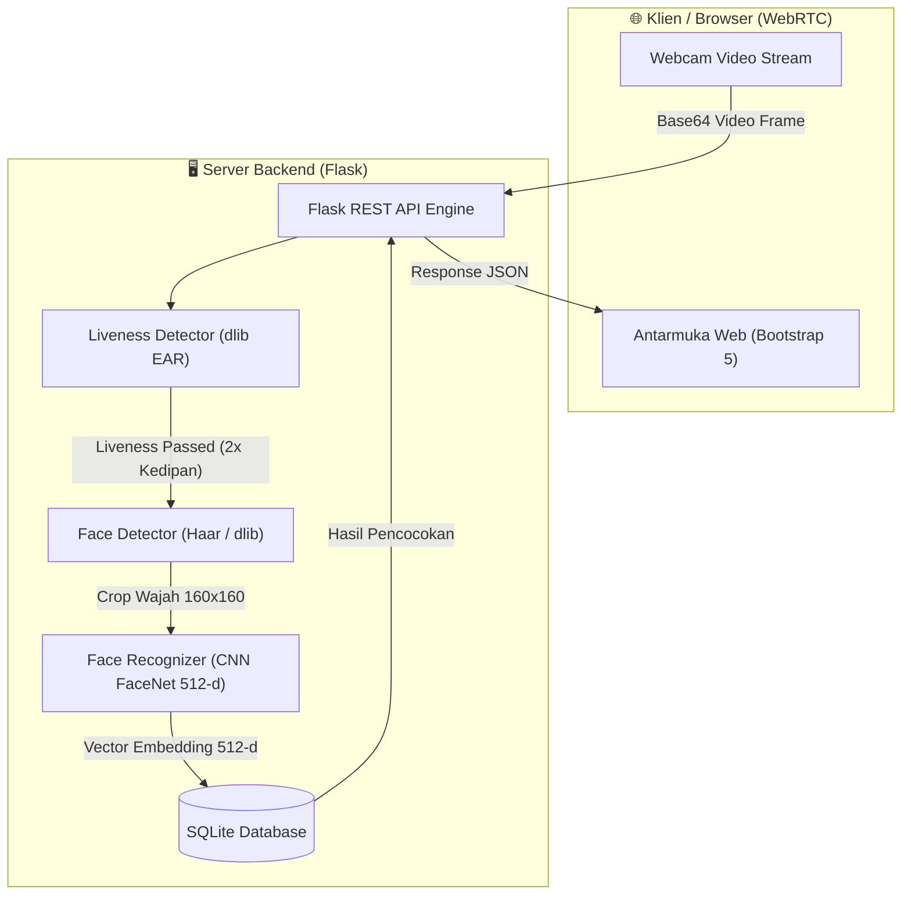
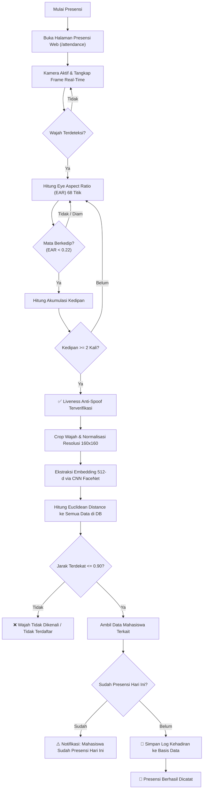

# Product Requirements Document (PRD) & Implementation Plan
## Sistem Presensi Digital Anti-Spoofing Berbasis Web dengan Convolutional Neural Network dan Deteksi Liveness Real-Time

- **Mata Kuliah:** Kecerdasan Tiruan  
- **Target Pengguna:** Absensi Mahasiswa (4 Anggota Kelompok)  
- **Target Lingkungan:** Localhost (Demo WebRTC + Flask)  
- **Fokus Utama Penilaian:** Sisi Artificial Intelligence / Machine Learning (CNN & Anti-Spoofing)

---

## 1. Latar Belakang & Deskripsi Masalah

Sistem presensi berbasis pengenalan wajah (*face recognition*) konvensional rentan terhadap serangan pemalsuan identitas (*presentation attack / spoofing*). Pengguna yang tidak bertanggung jawab dapat dengan mudah mengelabui kamera hanya dengan menghadapkan foto cetak (kertas) atau menampilkan foto wajah digital melalui layar ponsel (*replay attack*).

Proyek ini bertujuan membangun sistem presensi cerdas berbasis web yang memadukan:
1. **Deteksi Liveness Real-Time (Anti-Spoofing):** Memverifikasi keberadaan subjek biologis manusia asli melalui analisis rasio bukaan mata (*Eye Aspect Ratio / EAR*) menggunakan 68 titik *facial landmarks*.
2. **Convolutional Neural Network (CNN - FaceNet):** Mengekstraksi fitur visual wajah ke dalam vektor *face embedding* 512 dimensi untuk pencocokan identitas dengan presisi tinggi melalui metrik *Euclidean Distance*.
3. **Penyimpanan Data Terstruktur:** Basis data relasional SQLite untuk menyimpan profil mahasiswa, vektor embedding, dan rekam jejak kehadiran.

---

## 2. Arsitektur Sistem & Alur Kerja

### 2.1 Diagram Arsitektur Sistem


### 2.2 Alur Kerja Logika Presensi (User Flow)


---

## 3. Spesifikasi Teknis & Tech Stack

| Layer | Teknologi | Rationale / Alasan Pemilihan |
| :--- | :--- | :--- |
| **Bahasa Pemrograman** | Python 3.10+ | Standar industri untuk riset dan implementasi AI/ML. |
| **Web Framework** | Flask 3.x | Ringan, minim *boilerplate*, cepat dieksekusi di localhost. |
| **Computer Vision** | OpenCV (`opencv-python`) & `dlib` | Pemrosesan citra digital, konversi warna, dan ekstraksi *facial landmarks*. |
| **Deep Learning Framework** | PyTorch (`torch`, `torchvision`) | Framework komputasi tensor untuk inferensi CNN FaceNet. |
| **Model Face Recognition** | FaceNet (`InceptionResnetV1`) | Arsitektur CNN *state-of-the-art* dengan representasi embedding 512 dimensi berbasis *Triplet Loss*. |
| **Metode Anti-Spoofing** | Eye Aspect Ratio (EAR) | Komputasi geometris deterministik yang efisien dan real-time tanpa memerlukan training model tambahan yang berat. |
| **Basis Data** | SQLite 3 | *Serverless*, *zero-configuration*, menyimpan array numpy serial melalui adapter biner. |
| **Frontend UI** | HTML5, JavaScript (WebRTC), Bootstrap 5 | Pengambilan frame webcam tanpa plugin eksternal dan antarmuka responsif. |

---

## 4. Rincian Komponen Kecerdasan Buatan (AI/ML)

### 4.1 Deteksi Wajah (*Face Detection*)
* **Metode:** Kombinasi Haar Cascade Classifier (`haarcascade_frontalface_default.xml`) dengan *fallback* ke HOG-based Frontal Face Detector `dlib`.
* **Preprocessing:**
  1. Konversi frame BGR ke format Grayscale.
  2. Ekualisasi histogram citra (*Histogram Equalization*) untuk menstabilkan variasi kontras cahaya.
  3. Penambahan margin batas ($15\text{ px}$) agar seluruh kontur wajah (dahi hingga dagu) tidak terpotong saat di-*crop*.
  4. Penyesuaian ukuran menjadi tepat $160 \times 160$ piksel.

### 4.2 Deteksi Liveness Anti-Spoofing (*Eye Aspect Ratio / EAR*)
Menggunakan 68 titik koordinat *facial landmarks* model `shape_predictor_68_face_landmarks.dat`:
* **Mata Kanan:** Titik indeks 36 sampai 41.
* **Mata Kiri:** Titik indeks 42 sampai 47.

**Rumus Matematis EAR:**
$$EAR = \frac{\|p_2 - p_6\| + \|p_3 - p_5\|}{2 \cdot \|p_1 - p_4\|}$$

* **Kondisi Normal (Mata Terbuka):** Nilai EAR berada di kisaran $0.25 - 0.35$.
* **Kondisi Kedip (Mata Tertutup):** Nilai EAR anjlok di bawah ambang batas $\text{EAR} < 0.22$.
* **Logika Deteksi:** Kedipan dinyatakan valid jika EAR berada di bawah threshold selama $\ge 2$ frame konsekutif lalu kembali terbuka. Sistem mewajibkan minimal **2 kali kedipan** sebelum membuka akses pengenalan wajah.

### 4.3 Pengenalan Wajah CNN (*FaceNet Embedding & Matching*)
* **Arsitektur:** Inception-ResNet-v1 (pre-trained VGGFace2).
* **Normalisasi Input:**
  $$x_{\text{norm}} = \frac{x - 127.5}{128.0} \quad \in [-1.0, 1.0]$$
* **Ekstraksi Vektor:** Menghasilkan vektor embedding 512 dimensi yang dinormalisasi $L_2$-norm ($\|\vec{v}\|_2 = 1$).
* **Fungsi Jarak (Metrik Keputusan):**
  $$d(\vec{u}, \vec{v}) = \|\vec{u} - \vec{v}\|_2 = \sqrt{\sum_{i=1}^{512} (u_i - v_i)^2}$$
* **Threshold Keputusan:** $\theta = 0.90$.
  * Jika $d \le 0.90$ $\rightarrow$ Wajah Cocok (*Match*).
  * Jika $d > 0.90$ $\rightarrow$ Wajah Tidak Dikenali (*Unknown*).
* **Konversi Skor Konfidensi (%):**
  $$\text{Confidence} = \max\left(0, \min\left(100, \left(1.0 - \frac{d}{1.5 \cdot \theta}\right) \times 100\right)\right)$$

### 4.4 Algoritma Pencarian Ruang Fitur (BFS, DFS, Greedy, A* Search)
Selain pengenalan langsung, sistem dilengkapi modul eksplorasi graf kemiripan wajah (*Face Similarity Graph*) untuk membandingkan 4 paradigma algoritma pencarian kecerdasan buatan:
1. **BFS (Breadth-First Search):** Strategi *uninformed* menggunakan struktur data antrean FIFO. Mengeksplorasi simpul lapis demi lapis menjamin rute hop terpendek.
2. **DFS (Depth-First Search):** Strategi *uninformed* menggunakan tumpukan LIFO. Menelusuri satu cabang sampai kedalaman maksimal sebelum melakukan *backtracking*.
3. **Greedy Best-First Search:** Strategi *informed* berbasis heuristik $f(n) = h(n)$, di mana $h(n)$ adalah estimasi jarak Euclidean ke embedding target.
4. **A* Search (A-Star):** Strategi *informed* optimal berbasis fungsi evaluasi $f(n) = g(n) + h(n)$, menyeimbangkan biaya langkah penelusuran graf $g(n)$ dengan heuristik Euclidean $h(n)$.

---

## 5. Rencana Kerja Bertahap (Milestone Implementation Plan)

Struktur implementasi dirancang terbagi ke dalam 3 tahapan (*milestone*) agar progres pengerjaan terlihat bertahap, realistis, dan akademis:

### Milestone 1: Fondasi & Pengumpulan Data (Minggu 1-2)
- [x] Perumusan arsitektur sistem dan pembuatan dokumen PRD.
- [x] Penyiapan virtual environment Python (`venv`) dan dependensi inti (`torch`, `facenet-pytorch`, `opencv-python`, `dlib-bin`, `flask`).
- [x] Desain skema basis data SQLite untuk relasi mahasiswa, vektor embedding, dan log kehadiran.
- [x] Unduh bobot pre-trained `shape_predictor_68_face_landmarks.dat` dan `InceptionResnetV1`.

### Milestone 2: Pengembangan Core AI Engine & Evaluasi Awal (Minggu 3-4)
- [x] Implementasi modul ekstraksi wajah [ai/face_detector.py](file:///c:/Users/Lenovo/OneDrive/Desktop/Kecerdasan%20Tiruan/ai/face_detector.py).
- [x] Implementasi ekstraksi fitur dan perbandingan jarak vektor CNN [ai/face_recognizer.py](file:///c:/Users/Lenovo/OneDrive/Desktop/Kecerdasan%20Tiruan/ai/face_recognizer.py).
- [x] Pengambilan sampel foto 4 anggota kelompok (5-10 sampel per orang dengan variasi sudut & ekspresi).
- [x] Pengujian nilai separabilitas jarak matriks (*Intra-class distance* vs *Inter-class distance*) dan penentuan nilai *threshold* $\theta = 0.90$.
- [x] Temuan kelemahan: Sistem berhasil mengenali wajah, namun masih bisa tertipu oleh foto di layar HP. Hal ini menjadi urgensi penambahan modul *Liveness Detection*.

### Milestone 3: Integrasi Anti-Spoofing, Web App, & Validasi Akhir (Minggu 5)
- [x] Implementasi modul verifikasi liveness [ai/liveness_detector.py](file:///c:/Users/Lenovo/OneDrive/Desktop/Kecerdasan%20Tiruan/ai/liveness_detector.py) dengan algoritma EAR 68-point landmarks.
- [x] Pembangunan server backend [app.py](file:///c:/Users/Lenovo/OneDrive/Desktop/Kecerdasan%20Tiruan/app.py) dengan penanganan sesi liveness real-time.
- [x] Pembangunan antarmuka web interaktif:
  - Layar Presensi Live dengan HUD EAR & Animasi Kedipan (`/attendance`).
  - Layar Registrasi Wajah Multi-Sudut (`/register`).
  - Layar Riwayat Kehadiran & Filter Tanggal (`/history`).
  - Layar Manajemen Mahasiswa & Fitur Reset Demo (`/students`).
- [x] Pembuatan unit test otomatis [test_app.py](file:///c:/Users/Lenovo/OneDrive/Desktop/Kecerdasan%20Tiruan/test_app.py) (Hasil 100% Passed).
- [x] Pembuatan launcher otomatis satu klik [run.bat](file:///c:/Users/Lenovo/OneDrive/Desktop/Kecerdasan%20Tiruan/run.bat) dan panduan presentasi [README.md](file:///c:/Users/Lenovo/OneDrive/Desktop/Kecerdasan%20Tiruan/README.md).

---

## 6. Desain Basis Data (SQLite)

```sql
-- Tabel Profil Mahasiswa
CREATE TABLE IF NOT EXISTS mahasiswa (
    id INTEGER PRIMARY KEY AUTOINCREMENT,
    nim TEXT UNIQUE NOT NULL,
    nama TEXT NOT NULL,
    created_at TIMESTAMP DEFAULT CURRENT_TIMESTAMP
);

-- Tabel Vektor Embedding CNN FaceNet
CREATE TABLE IF NOT EXISTS face_embeddings (
    id INTEGER PRIMARY KEY AUTOINCREMENT,
    mahasiswa_id INTEGER NOT NULL,
    embedding array NOT NULL, -- Serialized 512-d numpy float array
    image_path TEXT,
    created_at TIMESTAMP DEFAULT CURRENT_TIMESTAMP,
    FOREIGN KEY(mahasiswa_id) REFERENCES mahasiswa(id) ON DELETE CASCADE
);

-- Tabel Catatan Kehadiran
CREATE TABLE IF NOT EXISTS kehadiran (
    id INTEGER PRIMARY KEY AUTOINCREMENT,
    mahasiswa_id INTEGER NOT NULL,
    mata_kuliah TEXT NOT NULL DEFAULT 'Kecerdasan Tiruan',
    tanggal TEXT NOT NULL,
    waktu TEXT NOT NULL,
    status TEXT NOT NULL DEFAULT 'Hadir',
    confidence REAL,
    photo_path TEXT,
    created_at TIMESTAMP DEFAULT CURRENT_TIMESTAMP,
    FOREIGN KEY(mahasiswa_id) REFERENCES mahasiswa(id) ON DELETE CASCADE
);
```

---

## 7. Rincian API Endpoints

| HTTP Method | Endpoint | Fungsi | Payload Input | Response Output |
| :--- | :--- | :--- | :--- | :--- |
| `GET` | `/` | Dashboard Sistem & Statistik Presensi | - | Halaman HTML |
| `GET` | `/register` | Halaman Pendaftaran Wajah | - | Halaman HTML |
| `POST` | `/api/register` | Mendaftarkan mahasiswa & ekstrak embedding | `{nim, nama, images: [...]}` | `{success, message}` |
| `GET` | `/attendance` | Halaman Presensi Live Kamera | - | Halaman HTML |
| `POST` | `/api/liveness/check` | Evaluasi frame untuk hitung EAR & kedipan | `{session_id, image}` | `{success, result: {ear, blink_count, liveness_passed}}` |
| `POST` | `/api/liveness/reset` | Mereset penghitung kedipan sesi | `{session_id}` | `{success, message}` |
| `POST` | `/api/recognize` | Ekstrak embedding FaceNet & simpan presensi | `{session_id, image, bypass_liveness}` | `{success, student, metrics: {euclidean_distance, confidence_pct}}` |
| `GET` | `/history` | Halaman Riwayat Presensi | `?tanggal=YYYY-MM-DD` | Halaman HTML |
| `GET` | `/students` | Manajemen Data Mahasiswa | - | Halaman HTML |
| `POST` | `/api/students/<id>/delete`| Hapus data mahasiswa (Reset Demo) | - | `{success, message}` |

---

## 8. Panduan Skenario Pengujian & Demo ke Dosen

### Skenario A: Registrasi Anggota (Data Enrollment)
1. Akses menu **Registrasi Wajah** (`/register`).
2. Masukkan NIM dan Nama dari masing-masing 4 anggota kelompok.
3. Ambil 5 sampel foto wajah dari sudut berbeda.
4. Klik **Daftarkan Mahasiswa**. Model FaceNet mengekstrak 5 vektor embedding berdimensi 512 dan menyimpannya ke database.

### Skenario B: Uji Pertahanan Anti-Spoofing (Foto di Layar HP)
1. Akses menu **Presensi Live** (`/attendance`).
2. Arahkan layar smartphone yang menampilkan foto salah satu anggota kelompok ke depan webcam.
3. **Hasil yang diharapkan:** Sistem mendeteksi wajah tetapi nilai kedipan tetap $0/2$ karena foto layar bersifat statis (EAR konstan). Status Anti-Spoof tetap **Merah / Belum Lolos**, dan proses presensi tidak akan pernah dieksekusi.

### Skenario C: Presensi Orang Asli (Verifikasi Penuh)
1. Anggota kelompok asli berdiri di depan kamera.
2. Lakukan kedipan mata secara wajar sebanyak 2 kali.
3. **Hasil yang diharapkan:** Indikator EAR merespons, kedipan terhitung $2/2$, status Anti-Spoof berubah menjadi **Hijau (Terverifikasi)**, CNN FaceNet langsung mengenali identitas, dan notifikasi presensi berhasil dicatat dengan nilai *Confidence Score*.

### Skenario D: Orang Luar / Tidak Terdaftar
1. Minta orang di luar 4 anggota kelompok untuk mencoba absen.
2. Liveness lolos (bisa berkedip), namun sistem menolak pengenalan wajah karena jarak Euclidean melampaui ambang batas $0.90$.

---

## 9. Keterbatasan Teknis & Strategi Menjawab Dosen

Berikut daftar kelemahan sistem yang didokumentasikan secara sengaja sebagai bahan argumen akademis jika dosen meminta fitur yang lebih kompleks:

1. **Liveness Berbasis Gerakan Kedipan (*Blink-Only*):**
   * *Kelemahan:* Dapat ditembus jika penyerang memutar rekaman video wajah yang sedang berkedip di depan kamera.
   * *Alasan Teknis:* Solusi anti-spoofing video memerlukan analisis tekstur moiré (*texture analysis*) atau model deep learning 3D (*FAS CNN*) yang membutuhkan dataset khusus ribuan video spoofing (misal CASIA-SURF) dan proses pelatihan dengan kartu grafis (GPU) performa tinggi yang berada di luar batasan durasi tugas kuliah.
2. **Ketiadaan Sensor Kedalaman Fisik (Hardware Limitations):**
   * *Kelemahan:* Tidak menggunakan sensor inframerah (IR) atau sensor kedalaman 3D (*Time-of-Flight / TrueDepth*).
   * *Alasan Teknis:* Sistem dirancang untuk dapat diakses secara universal pada perangkat laptop/PC standar yang hanya memiliki kamera webcam RGB 2D biasa.
3. **Pencarian Embedding Brute-Force:**
   * *Kelemahan:* Menggunakan pencarian jarak linear terhadap seluruh database.
   * *Alasan Teknis:* Untuk skala presensi kelompok (4-50 mahasiswa), pencarian linear membutuhkan waktu $<5\text{ ms}$. Algoritma pengindeksan vektor skala besar (seperti FAISS atau Annoy) baru diperlukan jika sistem menangani puluhan ribu mahasiswa.

---

## 10. Status Implementasi Proyek

| Modul / Berkas | Lokasi Berkas | Status Verifikasi |
| :--- | :--- | :---: |
| **Server Backend** | [app.py](file:///c:/Users/Lenovo/OneDrive/Desktop/Kecerdasan%20Tiruan/app.py) | ✅ Selesai & Berjalan |
| **Konfigurasi Parameter** | [config.py](file:///c:/Users/Lenovo/OneDrive/Desktop/Kecerdasan%20Tiruan/config.py) | ✅ Selesai |
| **Layer Basis Data SQLite** | [database.py](file:///c:/Users/Lenovo/OneDrive/Desktop/Kecerdasan%20Tiruan/database.py) | ✅ Selesai & Teruji |
| **AI Deteksi Wajah** | [ai/face_detector.py](file:///c:/Users/Lenovo/OneDrive/Desktop/Kecerdasan%20Tiruan/ai/face_detector.py) | ✅ Selesai & Teruji |
| **AI CNN FaceNet Recognizer** | [ai/face_recognizer.py](file:///c:/Users/Lenovo/OneDrive/Desktop/Kecerdasan%20Tiruan/ai/face_recognizer.py) | ✅ Selesai & Teruji |
| **AI Liveness Detector (EAR)** | [ai/liveness_detector.py](file:///c:/Users/Lenovo/OneDrive/Desktop/Kecerdasan%20Tiruan/ai/liveness_detector.py) | ✅ Selesai & Teruji |
| **Model Bobot Landmarks** | `models/shape_predictor_68_face_landmarks.dat` | ✅ Terpasang (99 MB) |
| **Antarmuka Web (6 Halaman)** | `templates/*.html` & `static/css/style.css` | ✅ Selesai & Responsif |
| **Unit Testing Otomatis** | [test_app.py](file:///c:/Users/Lenovo/OneDrive/Desktop/Kecerdasan%20Tiruan/test_app.py) | ✅ 100% Passed (4/4) |
| **Script Eksekusi Satu Klik** | [run.bat](file:///c:/Users/Lenovo/OneDrive/Desktop/Kecerdasan%20Tiruan/run.bat) | ✅ Siap Digunakan |
