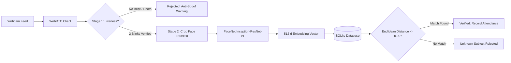

# 🛡️ PresensiAI — Biometric Smart Attendance System
> **Production-ready, real-time facial recognition attendance platform featuring CNN FaceNet (512-d embeddings) and Eye Aspect Ratio (EAR) anti-spoofing liveness detection with an Obsidian Neumorphic UI.**


-38B2AC?logo=tailwind-css&logoColor=white)


---

## 📌 Overview

**PresensiAI** is a full-stack biometric attendance system engineered to solve modern spoofing vulnerabilities in visual attendance workflows. Unlike conventional attendance apps that rely on static facial snapshots, PresensiAI integrates a dual-stage verification pipeline:

1. **Active Liveness Detection (Anti-Spoofing):** Analyzes 68 facial landmarks in real-time to compute the Eye Aspect Ratio (EAR). The system requires active biological micro-blinking before unlocking facial recognition, effectively neutralizing printed photo attacks and digital screen replays.
2. **Deep Metric Learning (FaceNet CNN):** Utilizes an Inception-ResNet-v1 architecture pretrained on VGGFace2 to project facial crops into an $L_2$-normalized 512-dimensional Euclidean hypersphere.
3. **Obsidian Neumorphic Interface:** Designed with a tactile, dark-mode cyberpunk aesthetic inspired by tactile hardware HUDs, featuring real-time WebRTC telemetry and zero-latency feedback.

---

## 🌟 Key Features

* **🛡️ Real-Time Anti-Spoofing Engine:**
  * 68-point facial landmark tracking via `dlib`.
  * Dynamic Eye Aspect Ratio (EAR) calculation per frame.
  * Configurable blink thresholds (`EAR < 0.22` for $\ge 2$ consecutive frames).
  * Fast-Bypass toggle for rapid testing environments.

* **🧠 Deep Facial Recognition Pipeline:**
  * OpenCV Haar Cascade face detection with dynamic padding and aspect alignment.
  * FaceNet 512-dimensional feature embedding extraction.
  * Nearest-neighbor classification using Euclidean Distance ($d \le 0.90$).
  * Confidence scoring metrics ($0\% - 100\%$).

* **⚡ Zero-Latency WebRTC Feed:**
  * Browser-native camera stream running at 10–15 FPS client-side frame processing.
  * Real-time HUD telemetry displaying live EAR values, blink counters, and bounding boxes.

* **🗄️ Lightweight & Secure Storage:**
  * SQLite database with custom NumPy array binary serialization.
  * Daily attendance deduplication (prevents double check-ins).
  * Interactive historical logs with date-picker filters.

* **🎨 Obsidian Biometrics Interface:**
  * Custom dark neumorphic theme (`#131313` obsidian surface, double inset/extrude shadows).
  * Monospace telemetry typography (`JetBrains Mono` + `Inter`).
  * Live status ribbons (*WebRTC Active*, *Model Loaded*, *Database Sync*).

---

## 🏗️ System Architecture



---

## 📁 Repository Structure

```
PresensiAI/
├── app.py                     # Primary Flask server & REST API endpoints
├── config.py                  # System thresholds, paths & hyperparameters
├── database.py                # SQLite layer & NumPy array vector adapters
├── requirements.txt           # Python dependencies
├── run.bat                    # One-click Windows runner script
├── test_app.py                # Automated unit test suite
├── ai/
│   ├── face_detector.py       # Haar Cascade face cropping & ROI extraction
│   ├── face_recognizer.py     # PyTorch FaceNet 512-d embedding generator
│   ├── liveness_detector.py   # 68-landmark EAR calculation & blink tracker
│   └── search_algorithms.py   # Classical graph & heuristic similarity search
├── models/
│   ├── haarcascade_frontalface_default.xml
│   └── shape_predictor_68_face_landmarks.dat
├── templates/
│   ├── base.html              # Unified Obsidian Neumorphic layout & HUD header
│   ├── index.html             # System dashboard & real-time telemetry metrics
│   ├── attendance.html        # Live camera scanning & biometric matching
│   ├── register.html          # Subject enrollment & multi-angle sample capture
│   ├── history.html           # Historical attendance audit log & date filter
│   └── students.html          # Registered identity matrix & database reset
└── data/                      # Local SQLite store & enrollment crops
```

---

## 🚀 Quick Start Guide

### 1. Prerequisites
* Python 3.10, 3.11, or 3.12 installed.
* A working webcam.

### 2. Installation

```bash
# 1. Clone the repository
git clone https://github.com/your-username/PresensiAI.git
cd PresensiAI

# 2. Create and activate a virtual environment
python -m venv venv

# Windows:
.\venv\Scripts\activate
# Linux/macOS:
source venv/bin/activate

# 3. Install dependencies
pip install -r requirements.txt
```

### 3. Model Weights Setup
Ensure the required pretrained weights are placed inside the `models/` directory:
* `haarcascade_frontalface_default.xml` (Included in repo)
* `shape_predictor_68_face_landmarks.dat` ([Download from dlib repository](http://dlib.net/files/shape_predictor_68_face_landmarks.dat.bz2))

### 4. Running the Application

**Option A (Windows 1-Click):**
Simply double-click `run.bat`.

**Option B (Command Line):**
```bash
python app.py
```

Navigate to **`http://127.0.0.1:5000`** in your browser.

---

## 📡 REST API Reference

| Endpoint | Method | Description |
| :--- | :--- | :--- |
| `/api/register` | `POST` | Enrolls a subject with NIM, Name, and $\ge 3$ face crops. |
| `/api/liveness/check` | `POST` | Processes webcam frame, returns EAR and blink count. |
| `/api/liveness/reset` | `POST` | Resets the active liveness session state on server. |
| `/api/recognize` | `POST` | Performs FaceNet 512-d extraction and attendance log. |
| `/api/students/<id>/delete` | `POST` | Deletes a subject and cascades stored embeddings. |

---

## 🧪 Running Automated Tests

Run the test suite to verify database operations, computer vision modules, and Flask routes:

```bash
python -m unittest test_app.py
```

---

## 📄 License

Distributed under the **MIT License**. See `LICENSE` for more information.
